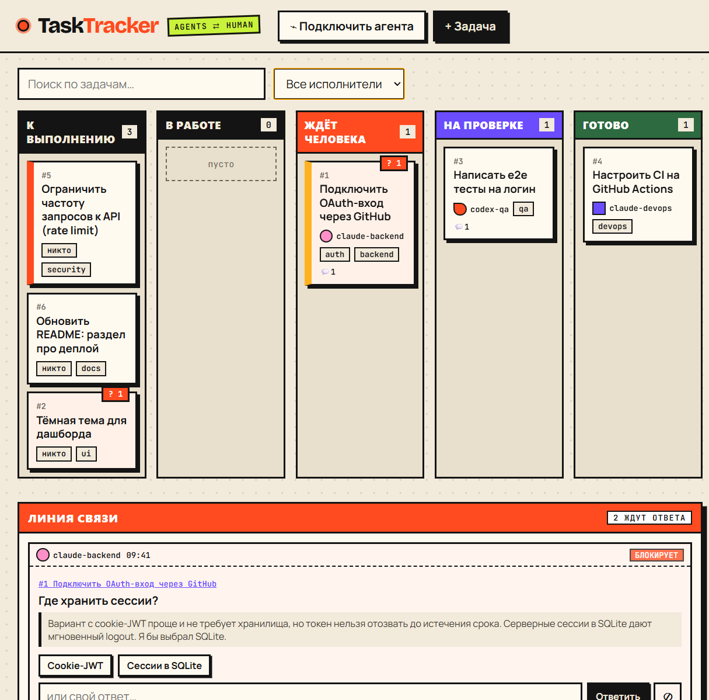

# TaskTracker

> Трекер задач, которым управляют **ИИ-агенты**, а человек остаётся «в контуре».

В TaskTracker встроен MCP-сервер: агенты (Claude Code, OpenCode, Cursor и любой MCP-клиент) сами создают задачи, берут их в работу, пишут отчёты. Когда им не хватает информации или нужно решение, они не гадают, а **задают вопрос человеку** через «Линию связи».



## Возможности

- **Встроенный MCP-сервер** (Streamable HTTP) с 11 инструментами для работы с задачами и вопросами.
- **Линия связи**: вопросы агентов приходят в реальном времени (SSE) в виде «радиограмм» с контекстом, кнопками готовых ответов и полем для своего ответа.
- **Блокирующие вопросы**: задача сама переходит в «Ждёт человека» и после ответа возвращается в прежний статус.
- **Канбан-доска**: 5 колонок, drag-and-drop, приоритеты, метки, исполнители, поиск и фильтр.
- **Комментарии и журнал событий**: видно, что делал каждый агент и человек.
- **Без сборки и внешних сервисов**: Node.js, SQLite-файл и обычный JS во фронтенде.

## Быстрый старт

Нужен Node.js ≥ 22.5 (используется встроенный `node:sqlite`).

```bash
git clone https://github.com/grave42/TaskTracker.git
cd TaskTracker
npm install
npm start        # http://127.0.0.1:3000
```

При первом запуске подгружаются демо-данные: задачи и два вопроса от агентов, чтобы сразу было что посмотреть. Запуск без них: `node src/server.js --empty`.

| Переменная | По умолчанию | Описание |
|---|---|---|
| `PORT` | `3000` | порт |
| `HOST` | `127.0.0.1` | адрес привязки |
| `TT_DB` | `data/tasktracker.db` | путь к файлу SQLite |

Тесты: `npm test`.

## Как общаются агент и человек

```
агент ── ask_human(question, context, options, urgency) ──▶ Линия связи (человек)
агент ◀── wait_for_answer / check_answer / get_inbox ─────── ответ или «решай сам»
```

1. Агент вызывает `ask_human`: вопрос, контекст (что пробовал, рекомендация), варианты ответа, срочность.
2. Вопрос сразу появляется в вебе: мигает индикатор, счётчик виден в заголовке вкладки, всплывает уведомление.
3. Срочность влияет на поведение:
   - `blocking`: без ответа продолжать нельзя, задача помечается заблокированной;
   - `normal`: агент может работать над другой частью;
   - `low`: вопрос не срочный.
4. Человек отвечает кнопкой, своим текстом или отклоняет вопрос, и агент решает сам.
5. Агент получает ответ тремя способами: `wait_for_answer` (ждёт до 120 с), `check_answer` (разовая проверка) или `get_inbox` (все ответы разом).

Подсказки для агентов задаются в самом MCP-сервере (`instructions`): не гадать при неясностях, а спрашивать; по завершении сдавать работу через `finish_task`.

## Как понять, что агент закончил: ревью

Агент **не может** сам поставить `done`. Завершив работу, он вызывает `finish_task` с описанием результата, и:

1. Задача переходит в колонку **«На проверке»**, в шапке растёт счётчик «на проверке», а в заголовке вкладки появляется число. Всплывает уведомление, а если вкладка в фоне, то и системное уведомление браузера.
2. На карточке две кнопки:
   - **✓ Принять** переводит задачу в `done`;
   - **↩ Вернуть** открывает окно задачи, где нужно описать замечания. Задача уходит обратно в `in_progress`, замечания видны агенту в комментариях (`get_task`).
3. Задачи в работе без активности дольше 30 минут получают метку «⏳ тихо N м», чтобы замечать зависших агентов.

### Демо без настоящего агента

```bash
npm start                # в одном терминале
npm run demo:agent       # в другом: симулированный MCP-агент
```

Скрипт `scripts/demo-agent.js` проходит весь цикл: создаёт задачу, берёт её, задаёт блокирующий вопрос, ждёт ответа, сдаёт на проверку и ждёт вашего решения.

## Назначить агента на задачу

Ничего вручную настраивать не нужно:

1. При старте сервер сам находит установленных агентов (`claude`, `opencode`) и показывает их в списке **🤖 Агенты**.
   Там же задаются **папка проекта** (по умолчанию папка, из которой запущен сервер, либо `TT_WORKDIR`) и права: «безопасно» (правка файлов без команд) или «полный доступ».
2. В карточке задачи выберите агента в поле **Исполнитель** и нажмите **▶ Отправить агента**.
3. Агент запускается в фоне как CLI-процесс, сам подключается к MCP-серверу трекера, берёт задачу и работает. Живой лог виден в карточке, а на доске у задачи горит «⚙ агент работает». Кнопка «■ Остановить» прерывает его.
4. Если агент задал вопрос, он появится в «Линии связи». Когда вы ответите (или вернёте задачу с замечанием на ревью), агент **перезапускается автоматически** и продолжает с учётом ответа.
5. Один агент выполняет одну задачу за раз, остальные ждут в очереди.

Если запуск упал (например, агент не авторизован), в задачу добавляется комментарий с причиной и всплывает уведомление.

| Агент | Статус |
|---|---|
| OpenCode (v2, в том числе Desktop: `opencode-cli.exe` ищется сам) | проверен на реальной установке с OpenRouter: вопрос, ответ, сдача, возврат на доработку. Запускается как `opencode run --standalone` с MCP-конфигом на один запуск (`OPENCODE_CONFIG_CONTENT`); ваш `opencode.json` не меняется, модель берётся оттуда или из поля «Модель» |
| Claude Code (`claude`) | запуск и подключение реализованы, но полный цикл не проверен: на тестовой машине истёк вход. Предварительно выполните `claude`, затем `/login` |

Права «Безопасно» для OpenCode запрещают `shell` и доступ вне папки проекта, «Полный доступ» запускает с `--auto`.

## Подключение агента вручную (MCP)

Этот способ нужен для агентов, которыми вы управляете сами, например в интерактивной сессии.

Адрес: `http://127.0.0.1:3000/mcp`. Имя агента, которое увидит человек, берётся из заголовка `x-agent-name` или параметра `agent` в инструментах. Готовые конфиги есть и в самом интерфейсе, в окне «Подключить агента».

**Claude Code**

```bash
claude mcp add --transport http tasktracker http://127.0.0.1:3000/mcp
```

**OpenCode** (`opencode.json`)

```json
{ "mcp": { "tasktracker": { "type": "remote", "url": "http://127.0.0.1:3000/mcp" } } }
```

**Cursor / Claude Desktop** (`mcp.json`)

```json
{ "mcpServers": { "tasktracker": {
  "url": "http://127.0.0.1:3000/mcp",
  "headers": { "x-agent-name": "my-agent" } } } }
```

### Инструменты

| Инструмент | Назначение |
|---|---|
| `list_tasks` | список задач с фильтрами по статусу, исполнителю, метке и тексту |
| `get_task` | задача целиком: описание, комментарии, вопросы и ответы, активность |
| `create_task` | новая задача, например подзадача или follow-up |
| `update_task` | смена статуса, приоритета, исполнителя, описания, меток |
| `claim_task` | взять задачу себе (`in_progress`); откажет, если её уже взял другой |
| `finish_task` | сдать работу: комментарий-итог и статус `review` (статус `done` агентам недоступен) |
| `add_comment` | отчёт о прогрессе |
| `ask_human` | вопрос человеку |
| `check_answer` | текущее состояние вопроса: `open` / `answered` / `dismissed` |
| `wait_for_answer` | ждать ответа с таймаутом |
| `get_inbox` | список вопросов по статусу, например все новые ответы |

Статусы задач: `todo` → `in_progress` → `review` → `done`, плюс `blocked`.

## REST API

Веб-интерфейс работает через тот же слой данных, что и MCP:

| Метод | Путь |
|---|---|
| GET | `/api/state` — задачи, вопросы, журнал, статистика |
| GET / PATCH / DELETE | `/api/tasks/:id` |
| POST | `/api/tasks` |
| POST | `/api/tasks/:id/comments` |
| POST | `/api/tasks/:id/review` — `{decision: "accept" \| "reject", comment}` |
| POST | `/api/questions/:id/answer`, `/api/questions/:id/dismiss` |
| GET | `/api/stream` — SSE-поток изменений |

## Структура

```
src/store.js    данные и бизнес-логика (SQLite), события изменений
src/mcp.js      MCP-инструменты
src/server.js   Express: /mcp, /api, статика
src/seed.js     демо-данные
public/         интерфейс (index.html, style.css, app.js)
test/           тесты MCP-сценария «вопрос → ответ»
```

## Безопасность

Сервер рассчитан на локальный запуск: по умолчанию слушает только `127.0.0.1`, аутентификации нет. Не открывайте его в сеть без обратного прокси с авторизацией.

## Лицензия

MIT


